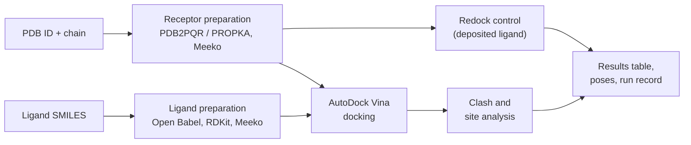

# SidA Docking Course

**Structure-based screening of ligands against the L-ornithine site of *Aspergillus fumigatus* SidA — with a built-in check on whether the docking can be trusted.**

[](https://github.com/leonardomarino/sida-docking-course/actions/workflows/ci.yml)


---

## Contents

- [Overview](#overview)
- [Quick start](#quick-start)
- [Installation](#installation)
- [Running the notebook](#running-the-notebook)
- [Using your own targets and ligands](#using-your-own-targets-and-ligands)
- [Troubleshooting](#troubleshooting)
- [Repository layout](#repository-layout)
- [Tests](#tests)
- [License](#license)
- [Author](#author)

---

## Overview

SidA (L-ornithine N<sup>5</sup>-monooxygenase) catalyses the first committed step of siderophore biosynthesis in *Aspergillus fumigatus* and is required for virulence in
invasive aspergillosis. Mammals have no equivalent enzyme, so SidA is a candidate antifungal target.

This repository contains a **Jupyter notebook** and the Python library behind it (`sidacore`) for one practical question:

> *Given a list of ligands from the literature, can each one be placed in the substrate site of a SidA crystal structure without overlapping the protein, and can the docking protocol be trusted on that structure?*

You provide **crystal structures** (PDB ID and chain) and **ligands** (SMILES). For every ligand–structure pair the notebook reports:

| Output | Meaning |
|---|---|
| **Clash count** | Atom pairs of the best pose that overlap the protein beyond a tolerance (Bondi van der Waals radii) |
| **Site occupancy** | Whether the best pose sits in the substrate site |
| **Redock control** | Whether the deposited ligand (L-ornithine) is recovered by the same protocol, so a structure the protocol cannot handle is flagged before any ligand is judged |
| **Reading** | A one-line verdict combining the three |



> **What this tool is not.** It screens by *fit*; it does **not** rank binding affinity. On SidA the Vina scores mis-rank the known substrates, and the redock control fails on
> some structures (4B63 fails at every box size tested). The notebook shows this openly rather than hiding it. The reasoning and data are in the notebook's
> "How to read the results" section and in `reports/`.

The notebook is written as a **laboratory notebook entry**: objective, background, methods, procedure and results, observations, interpretation, limits and 25 references
(22 with a PubMed record, matched by DOI and authors with `tools/verify_notebook_references.py`).

---

## Quick start

If you already have `git` and `conda`:

```bash
git clone https://github.com/leonardomarino/sida-docking-course.git ~/GitHub/sida-docking-course
cd ~/GitHub/sida-docking-course
conda env create -f notebooks/environment.yml
conda activate sida-screen
pip install -e .
cd notebooks && jupyter lab screen.ipynb
```

New to the command line, or something went wrong? Follow the step-by-step guide below.

---

## Installation

Everything runs in **one conda environment** (`sida-screen`) containing AutoDock Vina, Meeko, RDKit, Open Babel, Biotite, PDB2PQR/PROPKA and JupyterLab.
You do **not** need a GPU, Docker, administrator rights, or any other program.

### Requirements

| | |
|---|---|
| **Operating system** | Apple-silicon Mac (tested) · Linux x86-64 (tested) · Windows (not tested; use WSL 2 and follow the Linux steps) |
| **On a Mac, also** | the Xcode Command Line Tools and Homebrew (free; [Step 1](#step-1-install-git-and-conda) shows how) |
| **Disk space** | about 250 MB for the environment, plus the structure downloads |
| **Internet** | needed for installation and for the first run (structures are downloaded from RCSB) |
| **Time** | installation: a few minutes. First notebook run: ~75 s on a 24-core Linux workstation, ~8 min on an Apple-silicon laptop |
| **GPU** | not used |

The commands below are typed into a terminal (macOS: *Terminal* in Applications → Utilities).

### Step 1. Install git and conda

> **macOS: you need two free tools first.** Many Macs do not have them yet.
>
> 1. **Xcode Command Line Tools**: Apple's developer tools. They provide `git`, and Homebrew needs them. Install them with
>    `xcode-select --install` and click **Install** in the window that opens (a few minutes). Check with `xcode-select -p`, which prints a folder path once they are installed.
> 2. **Homebrew**: the Mac package manager used below to install conda. Open [brew.sh](https://brew.sh), copy the one-line command from the top of the page into Terminal and run it
>    (it also offers to install the Command Line Tools if they are missing). When it finishes it prints a **Next steps** section: run those lines, then **open a new Terminal window**.
>    Check with `brew --version`.

Check what you already have:

```bash
git --version
conda --version
```

- **`git` missing:** on a Mac this opens an installer prompt for the Xcode command line tools; accept it. On Linux use your package manager (`sudo apt install git`).
- **`conda` missing:** install one, then **open a new terminal window** so that it is found.

  **macOS** (tested route, using [Homebrew](https://brew.sh)):

  ```bash
  brew install --cask miniconda
  ```

  **Linux** (Miniforge, from the [conda-forge installer](https://github.com/conda-forge/miniforge)):

  ```bash
  curl -L -O "https://github.com/conda-forge/miniforge/releases/latest/download/Miniforge3-$(uname)-$(uname -m).sh"
  bash "Miniforge3-$(uname)-$(uname -m).sh"
  ```

  Any conda or mamba works. The environment file asks only for the free `conda-forge` channel.

### Step 2. Get the code

```bash
git clone https://github.com/leonardomarino/sida-docking-course.git ~/GitHub/sida-docking-course
cd ~/GitHub/sida-docking-course
```

Already cloned? Run `git pull` inside the folder.

### Step 3. Create the environment (once)

```bash
conda env create -f notebooks/environment.yml
```

This downloads and installs about 250 MB and takes a few minutes. It creates an environment named `sida-screen`.

### Step 4. Activate the environment

```bash
conda activate sida-screen
```

The prompt now starts with `(sida-screen)`. You must do this in every new terminal window before using the notebook.

If it prints `CondaError: Run 'conda init' before 'conda activate'`, your shell has not been told about conda yet. Either load it for this terminal only:

```bash
source "$(conda info --base)/etc/profile.d/conda.sh"
conda activate sida-screen
```

or fix it permanently (this edits your shell startup file; open a new terminal afterwards): `conda init zsh` — or `conda init bash` if your shell is bash (`echo $SHELL` tells you which).

### Step 5. Install the project code into the environment (once)

Run this from the repository root (the folder that contains `pyproject.toml`):

```bash
pip install -e .
```

### Step 6. Check the installation

```bash
python -c "import sidacore.screen as S; print(S.check_tools())"
```

Expected: four paths ending in `.../envs/sida-screen/bin/...` for `vina`, `obabel`, `mk_prepare_receptor.py` and `pdb2pqr30`.
A `None` means that program is missing; see [Troubleshooting](#troubleshooting).

Optional quick test (a few seconds; some tests are skipped because the structure cache is not in the repository, which is expected):

```bash
pytest -m "not slow" tests/test_screen.py -q
```

### Updating and uninstalling

```bash
cd ~/GitHub/sida-docking-course && git pull                    # new code
conda env update -f notebooks/environment.yml --prune          # only if environment.yml changed
conda env remove -n sida-screen                                # uninstall the environment
```

---

## Running the notebook

```bash
conda activate sida-screen
cd ~/GitHub/sida-docking-course/notebooks
jupyter lab screen.ipynb
```

In JupyterLab choose **Run → Run All Cells**. The first run downloads the structures 4B63 and 6X0J from RCSB and prepares the receptors, which takes several minutes on a laptop;
later runs reuse both.

The last cell compares your table with `reference_results.csv`, produced on Linux with CPU Vina 1.2.7. Vina is deterministic for a given seed on one machine but **not bit-identical across machines**.
On an Apple-silicon Mac the 12 `reading` values and the 3 control verdicts were identical to the reference, scores differed by at most 0.02 kcal/mol, and the oversized ligand's
clash count differed by one in two pairs. A different `reading` or control verdict is worth a look; a difference of a clash or two, or of a few poses, is not.

**Tip: work on a copy.** Running a notebook modifies the file, and git will then refuse to `git pull` updates. Keep the shipped notebook pristine and do your runs in a copy
(in JupyterLab: *File → Save Notebook As…*, or `cp screen.ipynb my_run.ipynb`). Keep the copy inside `notebooks/`, because the notebook finds its data files by relative path.
Give each run its own `RUN_NAME` in the parameters cell so that results are not overwritten.

---

## Using your own targets and ligands

Edit the **parameters cell** (section 2 of the notebook):

| Setting | What it takes |
|---|---|
| `TARGETS` | One `S.TargetSpec` per structure: PDB ID and chain, and `site_ligand` (the residue name of the ligand deposited in the site you care about) |
| `LIGANDS` | A dict of `name: SMILES`, the path of a `.csv` with columns `name,smiles`, or a `.smi` file |
| `SETTINGS` | Box size, seeds, exhaustiveness, pH and clash thresholds |
| `RUN_NAME` | Name of the output folder |

Section 3 of the notebook shows what is kept and what is stripped from each structure before anything is docked.
Results are written to `notebooks/screen_runs/<RUN_NAME>/`:

| File | Content |
|---|---|
| `results.csv` | One row per ligand–structure pair |
| `controls.csv` | Redock control per structure |
| `run.json` | Settings and the versions of every tool used |
| `poses/` | Best pose per pair (PDB) |
| `targets/` | Prepared receptors |

Things worth knowing:

- **`box_size` matters most.** 12 Å is site-sized: a ligand that does not fit is forced to clash. 22 Å is roomy: an oversized ligand docks clash-free at the rim, which is not a fit. Compare both before concluding.
- **No deposited ligand?** Give `center=(x, y, z)` instead of `site_ligand`; there is then no redock control.
- **Cofactors.** Only FAD, FDA and NADP can be kept (the only ones with a shipped Meeko template). NADPH (`NDP`), heme, FMN and others are stripped, and section 3 says so.
- **Clash thresholds** (0.4 Å overlap; 2.4 Å between polar atoms) were calibrated on only five deposited L-ornithine poses.

---

## Troubleshooting

| Symptom | Fix |
|---|---|
| `CondaError: Run 'conda init' before 'conda activate'` | See [Step 4](#step-4-activate-the-environment) |
| `conda: command not found` | Open a **new** terminal after installing conda; on Linux, run the Miniforge installer's `conda init` option |
| `ModuleNotFoundError: No module named 'sidacore'` | Run `pip install -e .` from the repository root with `(sida-screen)` active. In JupyterLab check that the kernel (top right) is the Python 3 of `sida-screen`, and start `jupyter lab` from the activated environment |
| `check_tools()` shows `None` | The environment is incomplete: `conda env remove -n sida-screen`, then repeat Step 3. For `pdb2pqr30` alone: `pip install pdb2pqr==3.7.1 propka==3.5.1` |
| The notebook stops in its first cell with "missing programs" | Same as above; the message names the missing program |
| A structure cannot be downloaded | RCSB needs internet (and a working proxy if you are behind one). Download the `.cif` yourself into `notebooks/structures_cache/`, named like `4B63.cif` |
| `git pull` is refused because `notebooks/screen.ipynb` was modified | You ran the shipped notebook. Restore it with `git checkout -- notebooks/screen.ipynb`, pull, and work on a copy (see [Running the notebook](#running-the-notebook)) |
| It is slow | Vina uses every core. Lower `exhaustiveness` or the number of `seeds` in the settings cell, or dock fewer ligands |

---

## Repository layout

```text
sida-docking-course/
├── notebooks/
│   ├── screen.ipynb            the screening notebook (laboratory-notebook format)
│   ├── environment.yml         conda environment for the notebook (linux-64, osx-arm64)
│   ├── reference_results.csv   reference run, used by the notebook's last cell
│   └── README.md               extended notes on the notebook
├── sidacore/                   Python library: preparation, boxes, redocking, clash analysis
│   └── screen.py               the code behind the notebook
├── tests/                      unit tests and a notebook execution test
├── tools/                      check_install.sh (install check), reference verification, environment-sync utilities
├── config/                     parameters of the SidA docking benchmark
├── confirm/                    optional Rosetta cross-checks (not needed for the notebook)
├── reports/                    documented validation steps (redocking, diagnosis, rescoring)
├── env/                        notes on the development environment
└── pyproject.toml
```

The notebook needs only `notebooks/` and `sidacore/`. The rest documents how the protocol was validated on SidA (benchmarks 4B63 and 6X0J) and requires the separate,
Linux-only `sida-docking` environment, which is **not** needed to use the notebook.

---

## Tests

```bash
pytest -m "not slow" tests/test_screen.py                            # seconds: clash arithmetic, ligand and target handling
pytest -m slow tests/test_screen.py tests/test_screen_notebook.py    # runs PDB2PQR, Meeko, Vina and the whole notebook (minutes)
```

Other test files in `tests/` belong to the validation steps and need the `sida-docking` environment (they use `fpocket`, which `sida-screen` does not contain).

### Check an installation from scratch

```bash
tools/check_install.sh            # builds a new throwaway environment, follows the steps above, runs every test
tools/check_install.sh --quick    # the same without the slow tests (docking and the whole notebook)
```

It needs only conda and git. It works on a copy of the repository with a new environment and a fresh package cache, so it never touches your own environments or your files, and it
removes what it created when everything passes (`--keep` keeps it). If a step fails it stops, says which, and keeps the folder and the log. Run it after installing to be sure that
the notebook will work, or when something does not.

### Continuous integration

[GitHub Actions](.github/workflows/ci.yml) repeats the installation steps above on a clean Linux and a clean macOS machine for every push
and once a week (so a change in an upstream package is noticed), then runs the quick and slow tests, including the whole notebook. `tests/test_install.py` checks that the
installed versions match `notebooks/environment.yml`, that every external program starts, and that the package is importable from outside the repository;
`tests/test_docs.py` keeps this README consistent with the files it describes. In CI a skipped test counts as a failure.

---

## License

Released under the [MIT License](LICENSE). The programs the environment installs (AutoDock Vina, Meeko, RDKit, Open Babel, PDB2PQR and others) are separate
projects with their own licenses and are not distributed in this repository. The optional `confirm/` checks use PyRosetta, which is free for academic use and needs a
license for commercial use; nothing in `sidacore/` imports it.

---

## Author

Leonardo Mariño-Ramírez
